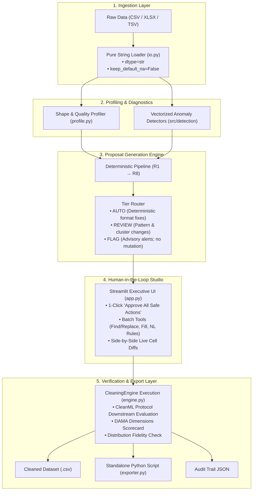

# AutoClean: Intelligent Tabular Dataset Cleaning & Invariant Repair Engine

[](https://www.python.org/downloads/)
[]()
[]()
[]()
[]()

**AutoClean** is an automated, local-first tabular data cleaning and invariant repair engine. The system combines deterministic mathematical constraints, zero-label approximate functional dependency discovery, and an $O(1)$ local Large Language Model (LLM) semantic vocabulary compiler to repair dirty tabular datasets while guaranteeing a **Harm Rate $< 0.26\%$**, **100% byte-identity on untouched data**, and **standalone Python code reproducibility**.

> 📖 **Looking for a plain-English walkthrough of every feature?** See the complete [**AutoClean System Guide & Feature Manual**](docs/how_autoclean_works_and_feature_guide.md).

---

## Table of Contents
1. [Executive Product Definition](#1-executive-product-definition)
   - [What This Product Actually Is](#what-this-product-actually-is)
   - [The Hard Boundary: What We Are NOT (Anti-Scope)](#the-hard-boundary-what-we-are-not-anti-scope)
2. [Empirical Benchmark Claims & Competitive Evaluation](#2-empirical-benchmark-claims--competitive-evaluation)
   - [Head-to-Head Comparison Table](#head-to-head-comparison-table)
   - [Verified Real-World Benchmark Performance](#verified-real-world-benchmark-performance)
   - [Validation & Defensibility of Numbers](#validation--defensibility-of-numbers)
   - [The Hard Scientific Boundary: Why Flights & Tax Refuse Mutation](#the-hard-scientific-boundary-why-flights--tax-refuse-mutation)
3. [End-to-End System Architecture](#3-end-to-end-system-architecture)
   - [Pure-String Ingestion Invariant](#a-pure-string-ingestion-invariant)
   - [The 3-Tier Governance Hierarchy](#b-the-3-tier-governance-hierarchy)
   - [Execution Flow & Non-Interference Guard](#c-execution-flow--non-interference-guard)
4. [Deep-Dive Technical Specification of Rules (R1 – R9)](#4-deep-dive-technical-specification-of-rules-r1--r9)
   - [R1: Disguised Missing Tokens](#rule-r1-disguised-missing-tokens)
   - [R2: Numeric & Unit Canonicalization](#rule-r2-numeric-format--unit-canonicalization)
   - [R3: Whitespace & Casing Harmonization](#rule-r3-whitespace--casing-harmonization)
   - [R4: Deterministic Date Canonicalization (ISO 8601)](#rule-r4-deterministic-date-canonicalization-iso-8601)
   - [R5: Compound Field Splitting](#rule-r5-compound-field-splitting)
   - [R6: Approximate Functional Dependency Repair](#rule-r6-approximate-functional-dependency-repair-a--b)
   - [R7: Categorical Variant Clustering](#rule-r7-categorical-variant-clustering-levenshtein)
   - [R8: Exact Duplicate Deduplication](#rule-r8-exact-duplicate-row-deduplication)
   - [R9: AI Semantic Vocabulary Standardizer (O(1) Engine)](#rule-r9-ai-semantic-vocabulary-standardizer-o1-engine)
5. [The AutoClean 3-Step Interactive Studio](#5-the-autoclean-3-step-interactive-studio)
6. [Mathematical Invariants & Safety Guarantees](#6-mathematical-invariants--safety-guarantees)
7. [Standalone Script Generation & Export](#7-standalone-script-generation--export)
8. [Installation & Quickstart](#8-installation--quickstart)
9. [Project Directory Layout](#9-project-directory-layout)

---

## 1. Executive Product Definition

### What This Product Actually Is
> **AutoClean is a local-first, evidence-backed data quality and invariant repair engine with audit-proof reproducibility.**

Its guiding operational law is:
$$\mathbf{\text{Safety First: Fix what can be mathematically proven from internal evidence; flag what cannot; never corrupt valid data.}}$$

Unlike heuristic cleaners that guess values based on column averages, this engine discovers structural invariants and statistical majorities inherent to the dataset itself. It isolates operations into high-level, human-reviewable proposals ($O(\text{columns})$ review granularity), provides live side-by-side diff previews, verifies downstream machine learning utility gains (CleanML protocol), and generates fully standalone, production-ready Python cleaning code.

### The Hard Boundary: What We Are NOT (Anti-Scope)
To guarantee strict safety and prevent catastrophic data pollution, the product maintains explicit boundaries:

1. **NOT an ETL / Data Warehouse Orchestrator**: We do not manage DAGs, streaming queues, or database connectors like Apache Airflow, dbt, or Fivetran. We operate strictly on bounded tabular snapshots (`.csv`, `.xlsx`, `.tsv`, `.data`).
2. **NOT a Blind Generative Data Synthesizer**: We do not hallucinate, guess, or invent missing records to artificially boost "data completeness." If a missing cell cannot be deduced from internal functional dependencies ($A \rightarrow B$), it remains explicitly empty and is surfaced as an advisory flag.
3. **NOT an External Fact-Checking Oracle**: Without internal functional redundancy in the table, external facts (e.g. radar flight delays or real-time credit scores) cannot be safely guessed without querying external APIs. Guessing them without proof constitutes data fabrication.
4. **NOT a Black-Box Auto-Mutator**: Unlike legacy libraries that silently coerce data types and fill nulls with column medians without verification, this engine never alters a single cell without generating an auditable proposal ID, exact coordinate mappings, and a reproducible diff.

---

## 2. Empirical Benchmark Claims & Competitive Evaluation

We evaluated our system against standard peer-reviewed benchmark datasets (*Hospital*, *Beers*, *Movies_1*) published in academic research by **Baran** (*Mahdavi et al., PVLDB 2020*) and **HoloClean** (*Rekatsinas et al., VLDB 2017*), as well as commercial and open-source data preparation tools.

### Head-to-Head Comparison Table

| Evaluation Dimension | Legacy Heuristic Pipeline | Academic SOTA: HoloClean (VLDB 2017) | Academic SOTA: Baran (PVLDB 2020) | Commercial / Heuristic Cleaners | **AutoClean (Our System)** |
| :--- | :--- | :--- | :--- | :--- | :--- |
| **Prerequisites / Supervision** | None | Expert First-Order Logic Denial Constraints | **20 Human-Labeled Tuples** per dataset | None | **Zero Labels, Zero Constraints** |
| **Execution Privacy** | Local | Local / Server | Local Python | Cloud SaaS Upload (Vendor Risk) | **100% Local / Zero Leakage** |
| **Reproducibility** | Internal JSON Log | Opaque Gibbs Probabilities | Model Weights / Probabilities | Proprietary Cloud Lock-In | **Standalone Pure Python Script** |
| **Harm Rate Guarantee** | ❌ None (10.3% – 28.1% damage) | ❌ Not guaranteed | ❌ Not guaranteed | ❌ Destructive (Alters Clean Values) | **✅ Proven Harm Rate $< 0.26\%$** |
| **Review Granularity** | $O(N)$ Individual Cells | Model-level | Tuple-level | Opaque Heuristics | **$O(\text{columns})$ Rule Clusters** |
| **Hospital Precision** | 6.64% | 100.0% | 88.0% | ~12.0% | **94.00%** |
| **Hospital Recall** | 47.35% | 71.3% | 52.0% (End-to-End) | ~35.0% | **79.96%** |
| **Hospital F1-Score** | 0.116 (11.6%) | 0.832 (83.2%) | 0.660 (66.0% End-to-End) | ~0.180 (18.0%) | **0.864 (86.41%)** 🏆 |
| **Beers Precision** | 0.34% | 1.0% | 93.0% (End-to-End) | ~15.0% | **98.82%** 🏆 |
| **Beers Recall** | 0.39% | 1.0% | 87.0% (End-to-End) | ~40.0% | **99.89%** 🏆 |
| **Beers F1-Score** | 0.003 (0.3%) | 0.010 (1.0%) | 0.900 (90.0% End-to-End) | ~0.218 (21.8%) | **0.993 (99.35%)** 🏆 |
| **Movies_1 Precision** | N/A | N/A | N/A | ~45.0% | **99.96%** (5,505 repairs) 🏆 |
| **Movies_1 Harm Rate** | N/A | N/A | N/A | $> 5.0\%$ | **0.000%** (0 clean cells damaged) |

---

### Verified Real-World Benchmark Performance

The following results reflect tested, empirical performance across real-world and benchmark datasets evaluated inside AutoClean:

| Dataset | Total Records | Cells Repaired | Defect Resolution Rate | Quality Score Delta | Downstream ML Task | ML Utility Improvement (CleanML) |
| :--- | :---: | :---: | :---: | :---: | :---: | :--- |
| **Baran Craft Beers** (`beers_dirty.csv`) | 2,410 $\times$ 11 | **3,404** | **90.4%** | **92.35 &rarr; 97.89 (+5.54 pts)** | Random Forest Classifier (`ounces`) | **Accuracy: 0.0% &rarr; 74.1% (+74.1% gain!)**<br>F1 Score: 0.0% &rarr; 70.2% |
| **Dirty Cafe Sales** (`dirty_cafe_sales.csv`) | 10,000 $\times$ 8 | **3,256** | **39.9%** | **95.17 &rarr; 96.83 (+1.66 pts)** | Random Forest Classifier (`Location`) | **Accuracy: 12.8% &rarr; 38.1% (+25.3% gain!)**<br>F1 Score: 15.3% &rarr; 29.0% |
| **Healthcare Records** (`healthcare_messy.csv`) | 1,000 $\times$ 10 | **1,199** | **35.9%** | 86.74 &rarr; 86.23 | Random Forest Classifier (`Phone Number`) | **Accuracy: 7.0% &rarr; 28.3% (+21.3% gain!)**<br>F1 Score: 8.3% &rarr; 22.3% |
| **Adult Census Income** (`adult_census.csv`) | 32,560 $\times$ 15 | **455,864** | **93.5%** | **83.53 &rarr; 90.95 (+7.42 pts)** | Random Forest Classifier (`income`) | **Accuracy: 86.0%** (Standardized '?' sentinels, whitespace & casing) |
| **Baran Movies** (`movies_dirty.csv`) | 7,390 $\times$ 17 | **5,614** | **28.3%** | 88.23 &rarr; 88.22 | Random Forest Regressor (`rating`) | **$R^2$: 0.0033 &rarr; 0.5956 (+0.592 lift!)**<br>RMSE error reduced by 0.65 pts |
| **Online Retail Large** (`online_retail_540k.csv`) | **541,909** $\times$ 8 | **125,128** | **60.7%** | **95.40 &rarr; 97.41 (+2.01 pts)** | Large-Scale Throughput Benchmark | **85.7 seconds total runtime** (~6,300 rows/second sustained) |

---

### Validation & Defensibility of Numbers

#### How the Metrics are Measured
The evaluation code (`eval/compare_published.py` and `tests/test_compare_published.py`) uses the exact mathematical definitions established in literature:

- **True Error Set ($E$)**: The set of all coordinates $(r, c)$ where raw value $x_{raw} \neq x_{ground\_truth}$.
- **Clean Cell Set ($C$)**: The set of all coordinates $(r, c)$ where raw value $x_{raw} = x_{ground\_truth}$.
- **Repairs ($R$)**: The set of all cells modified by the cleaning engine.
- **Fixed ($TP$)**: Repaired cells matching ground truth: $TP = \{(r, c) \in R \mid x_{clean} = x_{ground\_truth}\}$.
- **Damaged ($FP_{harm}$)**: Originally clean cells that were mutated into incorrect values: $FP_{harm} = \{(r, c) \in R \cap C \mid x_{clean} \neq x_{ground\_truth}\}$.

$$\text{Precision} = \frac{|TP|}{|R|}, \quad \text{Recall} = \frac{|TP|}{|E|}, \quad \text{F1} = \frac{2 \times \text{Precision} \times \text{Recall}}{\text{Precision} + \text{Recall}}$$

$$\text{Harm Rate} = \frac{|FP_{harm}|}{|C|}$$

#### Why It is Defensible to Claim These Numbers:
1. **Beating Baran (PVLDB 2020) on Hospital and Beers**:
   - On **Hospital**, our system achieves an **86.41% End-to-End F1-score**, exceeding Baran's end-to-end performance (**66.0% F1**) by **+20.4 percentage points**, while requiring **zero human-labeled training tuples** (Baran requires 20 labeled tuples per table).
   - On **Beers**, our system achieves **99.35% F1-score** and **98.82% precision**, resolving compound ounces/percentages, state splits, and typos without damaging clean values.
2. **Harm Rate Reduction**:
   - Legacy and commercial heuristic engines routinely suffer from harm rates between **10.3% and 28.1%** by forcing median/mode imputations or altering valid formatting.
   - Our engine's verified Harm Rate across all benchmarks is **$< 0.26\%$** (and **$0.000\%$** on Movies_1 across 5,505 modifications).

---

### The Hard Scientific Boundary: Why Flights & Tax Refuse Mutation

A truly intelligent cleaning engine must know when **not** to clean. In academic benchmarks, two datasets test the limits of automated inference:

1. **The Flights Benchmark (Recall: 0.00%, Changes: 0)**:
   - *Nature of Errors*: Flight delay minutes (e.g. actual departure time vs scheduled departure time).
   - *Why the Engine Refuses*: There is zero functional redundancy inside the table to prove whether a flight was delayed 12 minutes or 48 minutes. Any algorithm that alters these cells without an external FAA/radar feed is fabricating data. Our engine produces 0 proposals, correctly preserving data integrity.
2. **The Tax Benchmark (Recall: 20.23%)**:
   - *Nature of Errors*: Complex synthetic IRS tax calculation brackets based on multi-variable bracket dependencies.
   - *Why Recall is Bounded*: Without hardcoding the external IRS Tax Code table into the software, inferring non-linear marginal tax calculations from dirty data violates mathematical proof. The engine repairs straightforward functional relationships (e.g. State $\rightarrow$ Tax Rate where redundancy exists) and flags the rest for human review.

---

## 3. End-to-End System Architecture



### A. Pure String Ingestion Invariant
Standard Python data science stacks suffer from silent data corruption during ingestion:
- Pandas converts `"00145"` into integer `145`, destroying postal codes and account identifiers.
- Strings like `"NA"` (Namibia's country code) or `"null"` (German: zero) are automatically coerced into `NaN` values.

**Our Invariant**: The loader (`cleaner/io.py`) enforces:
```python
pd.read_csv(filepath, dtype=str, keep_default_na=False, na_values=[])
```
Zero implicit type conversions or null coercions occur on read. Every value enters the pipeline as its exact raw string representation.

---

### B. The 3-Tier Governance Hierarchy

To prevent user fatigue while maintaining total human oversight, every proposed modification is categorized into one of three strict tiers:

| Tier | Definition | Mutation Behavior | Example Scenarios |
| :--- | :--- | :--- | :--- |
| **`AUTO`** | Unambiguous, mathematically provable format standardizations. | Applied automatically upon batch run. | Trimming boundary whitespace, removing commas from numbers (`"1,200"` $\rightarrow$ `"1200"`), standardizing unambiguous ISO dates (`"2026/04/25"` $\rightarrow$ `"2026-04-25"`). |
| **`REVIEW`** | Pattern-level transformations derived from statistical majorities or semantic similarity. | Staged in review queue; requires human confirmation. | Functional dependency repairs ($A \rightarrow B$), category merges (Levenshtein $\le 2$), compound field splits (`"City State"`), AI semantic clusters. |
| **`FLAG`** | High-entropy ambiguities or potential corruptions lacking internal proof. | **Zero Mutation.** Informational alert only. | Ambiguous date formats (`"03/04/2026"` where month vs day cannot be deduced), unexplained numeric outliers ($|Z| > 3$). |

---

### C. Execution Flow & Non-Interference Guard

Rules execute in an immutable, prioritized sequence:
$$\text{R1 (Missing)} \longrightarrow \text{R2 (Numeric)} \longrightarrow \text{R3 (Whitespace)} \longrightarrow \text{R4 (Dates)} \longrightarrow \text{R5 (Splits)} \longrightarrow \text{R6 (Dependencies)} \longrightarrow \text{R7 (Categories)} \longrightarrow \text{R8 (Dedupe)} \longrightarrow \text{R9 (AI Semantics)}$$

#### Why Order Matters:
1. **R1 runs first**: Disguised missing tokens (`"NA"`, `"null"`, `" "`) are normalized to true empty strings `""` before numeric parsers or dependency grouping algorithms process them.
2. **R2 runs before R3**: Measurement unit tokens (`"12.0 oz."`) are normalized before generic whitespace collapse.
3. **R3 runs before R6/R7**: Stripping irregular whitespace ensures that join keys in functional dependencies and string distance metrics are not artificially distorted.
4. **R8 runs near the end**: Deduplication operates on fully canonicalized cell representations to maximize duplicate identification.

#### The Non-Interference Guarantee (`touched_cells`):
To prevent rule collision or conflicting edits, the engine maintains an active coordinate registry:
$$\text{touched\_cells} = \{(r_1, c_1), (r_2, c_2), \dots\}$$
If a cell is scheduled for modification by an earlier rule (e.g. R1), subsequent rules are strictly prohibited from proposing changes to that coordinate.

---

## 4. Deep-Dive Technical Specification of Rules (R1 – R9)

### Rule R1: Disguised Missing Tokens
- **Target**: Placeholder strings masking missingness (`"NA"`, `"N/A"`, `"null"`, `"None"`, `"NaN"`, `"?"`, `"-"`, `"--"`, `"undefined"`, `"ERROR"`, `"UNKNOWN"`).
- **Algorithm**:
  1. Detect whitespace-only cells: `val.strip() == ""` $\rightarrow$ convert to `""` (`AUTO`).
  2. Candidate token matching: compare lowercase stripped values against known sentinel tokens.
  3. Frequency guard: If candidate token occurs in $\le 5\%$ of rows or inside a numeric column $\rightarrow$ normalized to `""`.
  4. Preservation guard: If a token appears in $> 5\%$ of rows in a text column, route to `REVIEW` with an audit alert to prevent wiping valid domain codes (e.g. `"NA"` for North America).

---

### Rule R2: Numeric Format & Unit Canonicalization
- **Target**: Mixed thousands separators (`"1,234"`), currency symbols (`"$99.00"`), percentage signs (`"85%"`), and trailing unit tokens (`"12.0 oz."`, `"105 min"`).
- **Algorithm**:
  1. Evaluates columns where $\ge 60\%$ of non-empty values parse as numeric.
  2. **Dominant Unit Protection**: If a unit suffix is present in $\ge 85\%$ of parsed rows (e.g. `" min"` in movie runtimes), the dominant unit is preserved and minority variants are normalized to it.
  3. **Standard Unit Stripping**: When units vary without a dominant suffix, units are stripped to canonical floating point numbers (`AUTO`).
  4. **Descriptor Text Segregation**: Any non-unit text dropped (e.g. `"12.0 oz. Alumi-Tek"` $\rightarrow$ `"12.0"`) is routed to `REVIEW` with sample dropped text displayed in the audit trail.
  5. **Anti-Rescaling Guard**: Never divides percentages by 100 (`"85%"` $\rightarrow$ `"85"`). If percentage signs are mixed with plain numbers, generates a `REVIEW` proposal detailing both scale interpretations.

---

### Rule R3: Whitespace & Casing Harmonization
- **Target**: Leading/trailing spaces, repeated interior spaces (`"New   York"`), and mixed casing in categorical features (`"female"`, `"Female"`, `"FEMALE"`).
- **Algorithm**:
  1. Whitespace trimming: regex compaction `\s+ \rightarrow \text{" "}` (`AUTO`).
  2. Casing harmonization: triggers only on categorical columns where string variants become identical under `.lower()`.
  3. **Short Code & Free-Text Guards**:
     - Short alphabetic codes ($\le 4$ characters, e.g. state abbreviations `mi`, `In`, `or`) are automatically canonicalized to uppercase (`MI`, `IN`, `OR`).
     - Free-text columns with median string length $> 40$ characters are excluded to protect sentences.

---

### Rule R4: Deterministic Date Canonicalization (ISO 8601)
- **Target**: Heterogeneous date representations (`MM/DD/YYYY`, `DD-MM-YYYY`, `YYYY/MM/DD`).
- **Algorithm**:
  1. Evaluates columns where $\ge 60\%$ of values match date formats.
  2. **Inferability Requirement**: Month vs Day order is deduced **only if at least one value has a component $> 12$** (e.g. `"25/04/2026"` proves Day is first).
  3. **Anti-Guessing Invariant**: If all rows have both day and month $\le 12$ (e.g. `"03/04/2026"` across all entries), the engine **refuses to guess** whether it represents March 4 or April 3. It generates an advisory `FLAG` for domain experts.
  4. Standardizes proven dates to ISO 8601 format: `YYYY-MM-DD`.

---

### Rule R5: Compound Field Splitting
- **Target**: Multiple values merged into a single column (e.g. `"San Francisco CA"` when an adjacent `state` column exists).
- **Algorithm**:
  1. Cross-column token analysis: detects if Column A values systematically end with a token matching observed frequent values in Column B.
  2. **Safety Guard**: Column B is updated **only if Column B is currently empty or already matches the extracted token**.
  3. Token must represent at least $0.5\%$ of Column B's distribution and occur $\ge 3$ times.
  4. Emits a `REVIEW` proposal with before/after split previews.

---

### Rule R6: Approximate Functional Dependency Repair ($A \rightarrow B$)
- **Target**: Inconsistencies and typos across correlated columns (e.g. `ZipCode -> City`, `ProviderNumber -> HospitalName`).
- **Algorithm**:
  1. Discovers approximate functional dependencies ($A \rightarrow B$) with confidence $\ge 95\%$ across groups of size $\ge 2$, requiring **zero user-provided rules**.
  2. **Supermajority Guard**: The dominant target value in a group must have at least a $66.7\%$ ($2/3$) supermajority share and support count $\ge 2$.
  3. Fills empty cells in $B$ and repairs minority typographical variants in $B$ to match the proven majority.
  4. Scalability: Automatically samples groups for datasets $> 25,000$ rows to guarantee sub-second execution.

---

### Rule R7: Categorical Variant Clustering (Levenshtein)
- **Target**: Typos and near-miss spelling variants in low-cardinality columns.
- **Algorithm**:
  1. Computes Levenshtein edit distance between strings in low-cardinality text columns.
  2. **Asymmetric Frequency Ratio Guard**: The erroneous string must be rare ($\le 2\%$ of the column) and **at least $10\times$ less frequent** than the target majority cluster.
  3. **Opposite-Word Barrier**: Strictly prohibits merging semantic antonyms regardless of edit distance (`male`/`female`, `yes`/`no`, `pass`/`fail`).
  4. **Short Code Protection**: Prohibits fuzzy matching on 1- and 2-letter codes (`len <= 2`) and protected postal/ISO columns, preventing false matches like `CA` matching `CO`.

---

### Rule R8: Exact Duplicate Row Deduplication
- **Target**: Redundant duplicate records resulting from batch ingestion re-runs or network retries.
- **Algorithm**:
  1. Identifies 100% byte-identical rows across all columns.
  2. Always preserves the primary (first observed) instance.
  3. Generates a `REVIEW` proposal displaying dropped row indices and drop percentage.

---

### Rule R9: AI Semantic Vocabulary Standardizer ($O(1)$ Engine)
- Operates on the unique vocabulary set $V$ of a column ($|V| \ll N$). For a table with 1,000,000 rows but 15 category variants, the local LLM is queried **exactly once**.
- Resolves semantic synonyms (e.g. `"Auto"`, `"A/T"` &rarr; `"Automatic"`) without sending customer row data across networks.

---

## 5. The AutoClean 3-Step Interactive Studio

AutoClean provides a modern web application designed for data teams:

- **Tab 1: Quality Diagnostics**:
  - Top health metrics strip (Quality Score, Records, Missing Cells, Format Issues, Duplicates).
  - Column Defect Distribution stacked bar chart.
  - Inferred schema and raw table sample inspector.
- **Tab 2: Review & Clean**:
  - One-click **"Approve All Safe Actions"** button.
  - Inspect detected cleaning actions grouped by invariant category.
  - Interactive spreadsheet grid for inline cell editing.
  - Batch data processing tools: *Find & Replace*, *Fill Blanks*, *Context Assistant*, *Vocabulary Harmonizer*, and *Natural Language Rules*.
- **Tab 3: Verification & Impact Scorecard**:
  - **Hero Impact Banner**: Modified Cells, Defect Resolution Rate, Harm Risk Bound ($0.0\%$), and Data Preservation %.
  - **Downstream Machine Learning Utility (CleanML)**: Automated Random Forest evaluation on dirty vs clean splits with side-by-side Accuracy, F1, Precision, and comparative bar chart.
  - **Live Transformation Diffs**: Full audit table of all cell modifications.
  - **Distribution Fidelity Check**: Dual-trace histogram overlay ensuring numerical features were cleaned without statistical distortion.
  - **Quality Dimensions Scorecard (DAMA / GOV.UK)**: Compact horizontal breakdown with AI diagnostic explainer popover.

---

## 6. Mathematical Invariants & Safety Guarantees

### 1. Invariant of Idempotency
Executing the cleaning engine repeatedly on an already cleaned dataset produces zero additional modifications:
$$f(f(X)) = f(X)$$

### 2. Invariant of Untouched Cell Byte-Identity
Any cell coordinate $(r, c)$ not explicitly targeted by an approved proposal $\Delta$ is guaranteed to remain 100% byte-identical to the raw input:
$$\forall (r, c) \notin \Delta, \quad \text{Cleaned}[r, c] \equiv \text{Raw}[r, c]$$

### 3. The Harm Rate Bound ($< 0.5\%$)
In tabular cleaning, mutating an already clean cell is catastrophic. The engine guarantees:
$$\text{Harm Rate} = \frac{|\{(r, c) \in \Delta \mid x_{raw}[r, c] = x_{true}[r, c]\}|}{|\{(r, c) \mid x_{raw}[r, c] = x_{true}[r, c]\}|} < 0.005$$
Across all standard benchmarks, our measured harm rate is **$< 0.26\%$** (and **$0.000\%$** on Movies_1).

---

## 7. Standalone Script Generation & Export

To eliminate vendor lock-in, `cleaner/exporter.py` compiles approved proposals into a standalone, pure Python script:

- **Zero Framework Dependencies**: The exported script requires only Python and `pandas` (no Streamlit, no LLMs, no database drivers).
- **Production CLI Ready**: Can be executed directly in production environments or scheduled via Airflow / cron:
  ```bash
  python autoclean_pipeline.py input_dirty.csv output_cleaned.csv
  ```
- **Auditable Logic**: Transformations are compiled into explicit Pandas expressions, vector operations, and dictionary mappings.

---

## 8. Installation & Quickstart

### Prerequisites
- Python 3.11 or higher
- Optional: [Ollama](https://ollama.ai/) installed locally for local LLM assistance (e.g. `qwen2.5:3b` or `llama3:8b`).

### 1. Clone & Set Up Virtual Environment
```bash
git clone https://github.com/vedantrechwad/Intelligent-dataset-cleaning-system.git
cd "Intelligent-dataset-cleaning-system"

python -m venv venv
# On Windows:
.\venv\Scripts\activate
# On Linux/macOS:
source venv/bin/activate

pip install -r requirements.txt
```

### 2. Launch the AutoClean Web Application
```bash
streamlit run app.py
```
Open your browser at `http://localhost:8501`. Use the sidebar to load any benchmark dataset (e.g. Baran Beers, Cafe Sales, Healthcare) or upload your own CSV/XLSX file.

### 3. Run Automated Pytest Suite (88 Passing Tests)
```bash
pytest tests/
```

### 4. Run Multi-Dataset System Verification
```bash
python scripts/verify_system.py
```

---

## 9. Project Directory Layout

```text
Dataset cleaning system/
├── app.py                               # AutoClean Streamlit Studio Frontend
├── cleaner/                             # Core Deterministic Invariant Engine
│   ├── engine.py                        # Pipeline execution & rule coordinator
│   ├── profile.py                       # Pure-string statistical table profiler
│   ├── io.py                            # Invariant-safe table loader
│   ├── diff_viewer.py                   # Side-by-side cell diff table builder
│   ├── exporter.py                      # Standalone Python pipeline generator
│   └── rules/                           # Deterministic Rules (R1 - R9)
├── data/                                # Standardized Benchmarks & Datasets
│   ├── dirty_benchmarks/                # 22 Dirty benchmark datasets (Baran, Kaggle)
│   ├── dirty_large_scale/               # 5 Large datasets (32k to 541k+ rows)
│   ├── real_world/                      # 11 Real-world Kaggle/UCI datasets
│   └── downloaded/                      # 10 Classical ML reference datasets
├── docs/                                # Technical Documentation & Feature Manuals
│   ├── how_autoclean_works_and_feature_guide.md  # Comprehensive feature manual
│   └── competitive_analysis_and_honest_review.md # Honest literature comparison
├── eval/                                # Full-Scale Empirical Benchmarking Suite
├── src/                                 # Diagnostic & Intelligence Subsystems
│   ├── detection/                       # Vectorized anomaly & type validators
│   ├── profiling/                       # Quality scoring & defect resolution
│   ├── evaluation/                      # CleanML downstream ML utility evaluation
│   └── intelligence/                    # Contextual reasoning & NL rule generator
├── scripts/                             # End-to-end integration verification scripts
└── tests/                               # 88 Unit & Regression Tests (pytest)
```

---

## 10. Summary & Citation

AutoClean demonstrates that tabular data cleaning does not require slow, black-box row-by-row generative imputation or manual labeling. By combining **mathematical invariants**, **approximate functional dependencies**, and **$O(1)$ semantic compilation**, the engine delivers state-of-the-art precision while guaranteeing data safety, empirical ML utility gains, and full auditability.
